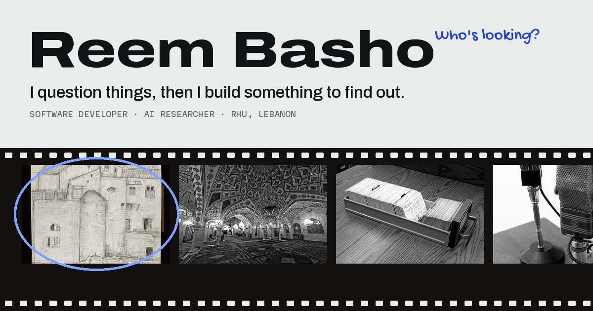

  

<h3 align="center">Hi, I'm Reem. I question things, then I build something to find out.</h3>

  CS senior at Rafic Hariri University · team lead at TechTalks · Saida, Lebanon

  

---

### Who's looking?

My portfolio shows the same person through two lenses. Pick the one you came for:

<table>
  <tr>
    <td width="50%" valign="top">
      <b>Hiring a developer or a team lead?</b> 
      Tested web products, Arabic RTL apps, and a team of four developers driving AI coding agents on one codebase.  
      <a href="https://reemb-prog.github.io/?lens=build"><b>Open the build lens →</b></a>
    </td>
    <td width="50%" valign="top">
      <b>Looking for a curious researcher?</b> 
      Small, honest experiments in diffusion and multimodal AI, written up with exactly where they fall short.  
      <a href="https://reemb-prog.github.io/?lens=research"><b>Open the research lens →</b></a>
    </td>
  </tr>
</table>

### Right now

- Leading four developers, and their four AI agents, building one product in parallel through a Jira-synced harness (TechTalks internship).
- Chasing a question: where along a diffusion model's path from noise to image is there still room to be creative?
- Writing down what I learn on [my articles page](https://reemb-prog.github.io/articles/).

### A few questions I built something to answer

- **Does a diffusion model still need its guide at step 29?** Adaptive ControlNet stopping on Stable Diffusion 1.5.
- **How does an Arabic app feel native, not translated?** A mosque course app with 228 Vitest tests.
- **Can a digital memory book feel like turning real pages?** A canvas editor with 3D page turns and MP4 export.
- **Can 429 pages answer you without a language model?** A cited-answer catalog chatbot built on classical NLP.

The full story behind each one, including what didn't work, is on **[my portfolio →](https://reemb-prog.github.io/)**

### CV

[Software engineer CV](https://reemb-prog.github.io/cv/Reem-Basho-CV-Software-Engineer.pdf) (1 page) · [Research CV](https://reemb-prog.github.io/cv/Reem-Basho-CV-Research.pdf) (2 pages)

### Say hi

[LinkedIn](https://www.linkedin.com/in/reem-basho/) · [BashoRW@students.rhu.edu.lb](mailto:BashoRW@students.rhu.edu.lb) · I like questions. Send me a hard one.
